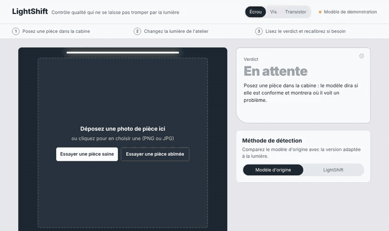
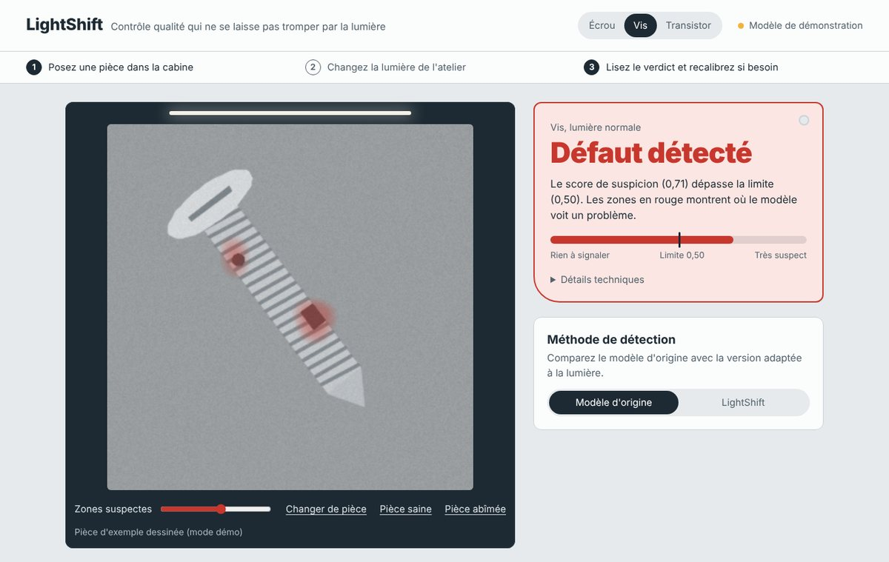
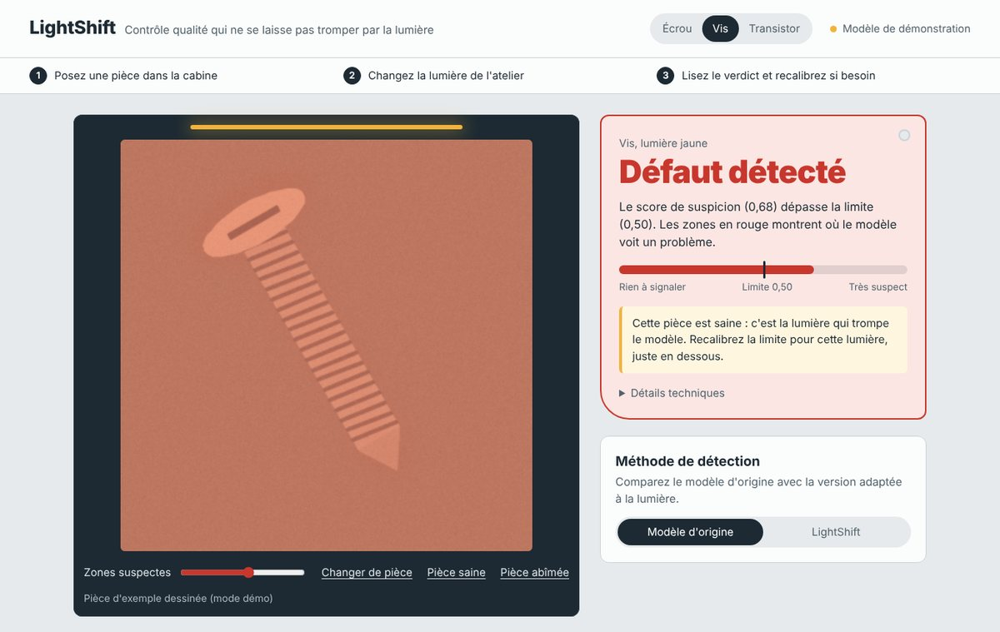
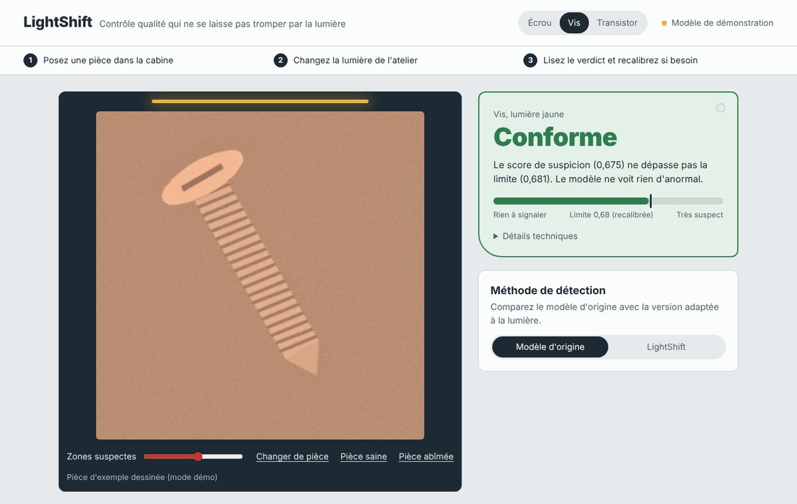
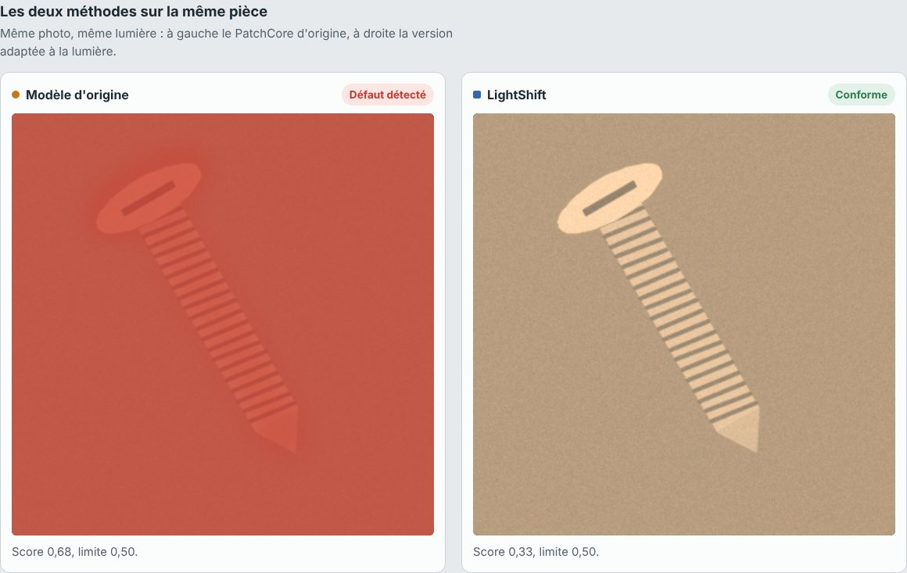
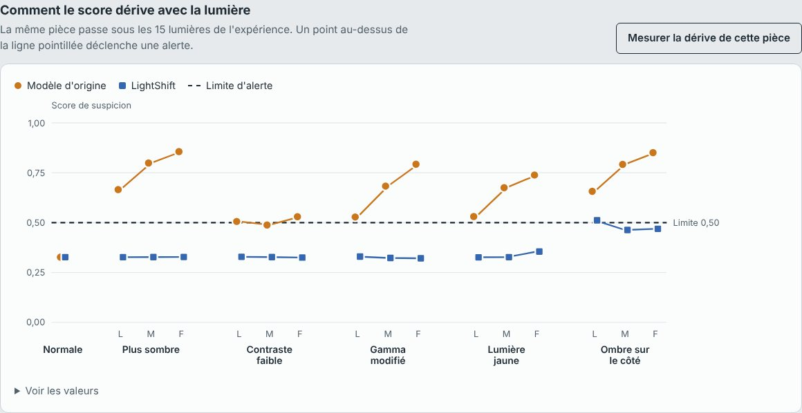

# LightShift-PatchCore

### Evaluating PatchCore Robustness Under Lighting Distribution Shifts

## 1. Project Overview

This project investigates the robustness of **PatchCore**, an unsupervised visual anomaly detection method, under changes in lighting conditions.

In industrial environments, variations in illumination can affect the visual appearance of objects and potentially reduce the performance of anomaly detection systems.

The main objective is to evaluate how different photometric transformations influence PatchCore's ability to detect and localize anomalies.

The experimental study uses the **MVTec Anomaly Detection (MVTec AD)** dataset and focuses on three industrial object categories.

The project establishes a PatchCore baseline trained on original normal images and evaluates its performance on test images affected by synthetic lighting variations.

## 2. Dataset

The experiments are conducted using the **MVTec Anomaly Detection (MVTec AD)** dataset, a benchmark for unsupervised industrial anomaly detection.

The following categories are selected:

- `metal_nut`
- `screw`
- `transistor`

Each category contains:

- **Training images:** normal images located in `train/good`.
- **Test images:** normal and anomalous images located in `test`.
- **Ground-truth masks:** pixel-level annotations for anomalous test images, located in `ground_truth`.

### Dataset Organization

The original dataset is stored locally in:

```text
data/raw/mvtec_anomaly_detection/
├── metal_nut/
├── screw/
└── transistor/
```

The original dataset is preserved separately from the generated images.

The dataset is not included in this GitHub repository. Users must download it from the official source and place the selected categories in the directory shown above.

Dataset source: [MVTec Anomaly Detection Dataset](https://www.mvtec.com/research-teaching/datasets/mvtec-ad)

## 3. Data Preparation

The data preparation process includes:

1. Loading the three selected MVTec AD categories.
2. Organizing the original training and test images.
3. Generating synthetic lighting variations.
4. Associating the corresponding ground-truth masks with transformed test images.

The original dataset is retained in `data/raw/`, while the generated images and masks are stored locally in `data/processed/`.

### Ground-Truth Masks

For anomalous images, the original MVTec AD masks are reused because the photometric transformations do not modify the spatial location of defects.

For normal images (`good`), completely black masks are generated to indicate the absence of anomalies.

The processed masks follow the same category, transformation, severity and defect-folder organization as the corresponding test images.

A consistency check was performed to verify image-mask correspondence:

- 195 folders checked.
- 195 exact filename and ordering matches.
- 0 mismatches detected.

## 4. Lighting Shift Generation

Five photometric transformations are implemented using **OpenCV** and **NumPy**.

| Transformation | Description |
|---|---|
| Brightness | Changes the overall image brightness. |
| Contrast | Modifies the difference between light and dark regions. |
| Gamma | Applies gamma correction to image intensities. |
| Color Temperature | Changes the color balance of the image. |
| Shading | Introduces a spatial illumination gradient. |

Each transformation is generated at three severity levels:

- **Severity 1:** low intensity.
- **Severity 2:** medium intensity.
- **Severity 3:** high intensity.

The transformations are applied to both training and test images to build the processed dataset.

For the PatchCore baseline, the model is trained using the original normal training images. The transformed test images are then used to evaluate its robustness under different lighting conditions.

### Processed Data Organization

The locally generated images and masks follow this structure:

```text
data/processed/
└── <category>/
    ├── train/
    │   └── <transformation>/
    │       └── severity_<level>/
    ├── test/
    │   └── <transformation>/
    │       └── severity_<level>/
    │           ├── good/
    │           └── <defect_type>/
    └── masks/
        └── <transformation>/
            └── severity_<level>/
                ├── good/
                └── <defect_type>/
```

## 5. PatchCore Baseline

### Model Description

PatchCore is an unsupervised visual anomaly detection method.

It extracts local feature representations from normal training images and builds a memory bank containing representative normal features.

During inference, features extracted from a test image are compared with the normal memory bank. Large distances from normal feature representations indicate potentially anomalous regions.

This approach provides both image-level anomaly detection and pixel-level anomaly localization.

### Model Configuration

The baseline uses the following configuration:

| Parameter | Value |
|---|---|
| Model | PatchCore |
| Backbone | Wide ResNet50-2 |
| Feature layers | `layer2`, `layer3` |
| Pretrained weights | Enabled |
| Coreset sampling ratio | 0.1 |
| Number of neighbors | 9 |
| Execution device | CPU |

A separate PatchCore model is trained for each selected category:

- `metal_nut`
- `screw`
- `transistor`

The models are trained using the original normal training images.

The trained checkpoints are stored locally in:

```text
results/Patchcore/
```

**Note:** Model checkpoints are not included in the GitHub repository. They must be generated by running the training scripts.

## 6. Experimental Evaluation

After training, the baseline models are evaluated under different lighting conditions.

The experimental protocol covers:

- **3 object categories**
- **5 lighting transformations**
- **3 severity levels**

This gives a total of:

**3 × 5 × 3 = 45 evaluation configurations.**

For each configuration, the corresponding trained PatchCore model is evaluated on transformed test images.

The original normal training images are retained as the reference for the model's normal memory bank.

The corresponding ground-truth masks are used to evaluate anomaly localization at the pixel level.

### Evaluation Metrics

Four metrics are collected:

| Metric | Purpose |
|---|---|
| Image AUROC | Measures the ability to distinguish normal and anomalous images. |
| Image F1-Score | Measures the balance between precision and recall at image level. |
| Pixel AUROC | Measures the ability to distinguish normal and anomalous pixels. |
| Pixel F1-Score | Measures the balance between precision and recall at pixel level. |

AUROC evaluates discrimination across different thresholds, while F1-Score depends on the decision threshold used during evaluation.

### Original Test Baseline

The three trained models were first evaluated on the original MVTec AD test images.

| Category | Image AUROC | Image F1 | Pixel AUROC | Pixel F1 |
|---|---:|---:|---:|---:|
| metal_nut | 0.9961 | 0.9838 | 0.9869 | 0.8386 |
| screw | 0.9695 | 0.9461 | 0.9892 | 0.3698 |
| transistor | 0.9913 | 0.9351 | 0.9726 | 0.6084 |

These results establish the reference performance for the lighting robustness experiments.

### Results Under Lighting Shifts

All 45 evaluation configurations were completed successfully.

| Transformation | Image AUROC | Image F1 | Pixel AUROC | Pixel F1 |
|---|---:|---:|---:|---:|
| Brightness | 0.9825 | 0.9478 | 0.9827 | 0.5969 |
| Contrast | 0.9844 | 0.9532 | 0.9830 | 0.5994 |
| Gamma | 0.9791 | 0.9289 | 0.9799 | 0.5527 |
| Color Temperature | 0.9513 | 0.8893 | 0.9780 | 0.4374 |
| Shading | 0.9506 | 0.9378 | 0.9561 | 0.5371 |

Values represent averages across the three categories and three severity levels for each transformation.

### Comparison With Original Test Conditions

The following table presents the relative performance changes between the original test baseline and the average results across the 15 lighting configurations for each category.

| Category | Image AUROC | Image F1 | Pixel AUROC | Pixel F1 |
|---|---:|---:|---:|---:|
| metal_nut | -0.21% | -1.46% | -0.16% | -2.61% |
| screw | -4.05% | -4.98% | -1.65% | -28.71% |
| transistor | -0.68% | -0.99% | -0.31% | -8.98% |

Negative values indicate a decrease in performance compared with the original test baseline.

### Main Experimental Observations

The experimental results reveal several trends:

**1. Category sensitivity**

- `metal_nut` maintains relatively stable performance under the evaluated lighting conditions.
- `screw` exhibits the strongest degradation, particularly in pixel-level F1-Score.
- `transistor` shows intermediate behavior, with relatively stable AUROC values and a more noticeable decrease in pixel-level F1-Score.

**2. Transformation sensitivity**

- Brightness and contrast generally preserve the model's discrimination performance.
- Gamma introduces moderate performance degradation.
- Color temperature significantly affects image-level F1 and pixel-level F1.
- Shading produces the lowest average Image AUROC and Pixel AUROC.

**3. Severity influence**

Increasing transformation severity generally has a stronger impact on certain transformations.

For example:

- Color temperature Image AUROC decreases from 0.9804 at severity 1 to 0.9024 at severity 3.
- Shading Image AUROC decreases from 0.9793 to 0.9150.
- Shading Pixel AUROC decreases from 0.9789 to 0.9281.

These observations indicate that PatchCore's robustness depends on both the type and intensity of the lighting transformation.

### Results and Visualizations

Detailed experimental results are stored in:

```text
results/
├── baseline_metrics.csv
├── lighting_evaluation.csv
├── analysis/
│   ├── baseline_vs_lighting.csv
│   ├── evaluation_report.txt
│   ├── successful_configurations.csv
│   ├── summary_by_category_shift.csv
│   ├── summary_by_shift.csv
│   └── summary_by_shift_severity.csv
└── figures/
```

The figures include:

- Image AUROC comparisons by transformation and severity.
- Image F1-Score comparisons.
- Pixel AUROC comparisons.
- Pixel F1-Score comparisons.
- Category comparison heatmaps.

## 7. Methodological Considerations and Limitations

An important methodological limitation concerns the validation and threshold calibration procedure.

In the training script, the `val_split_mode` parameter was not explicitly specified when creating the `MVTecAD` datamodule.

In Anomalib 2.7.1, the default value is `SAME_AS_TEST`. Consequently, the validation set uses the same split as the test set.

Anomalib's PostProcessor determines adaptive thresholds during validation using anomaly scores and ground-truth labels.

Therefore, the original test set was also involved in threshold calibration. The original-test F1-Scores should not be interpreted as independent held-out test measurements.

For the lighting evaluations, the checkpoints retain the thresholds calibrated during the original validation procedure. The transformed test images are evaluated using these source-condition thresholds.

The following limitations should be considered:

- AUROC metrics are useful for comparing anomaly score discrimination independently of a fixed binary decision threshold.
- F1-Scores are threshold-dependent and must be interpreted with the calibration limitation described above.
- The experiments establish an exploratory baseline rather than a fully independent threshold-calibration benchmark.
- A rigorous comparison with threshold calibration methods requires separate calibration and test datasets.

For future experiments, a common and independent calibration/test protocol should be used across all compared methods.

## 8. Project Structure

The GitHub repository contains the source code, documentation and experimental outputs.

```text
LightShift-PatchCore/
│
├── README.md
├── requirements.txt
├── .gitignore
│
├── src/
│   ├── augmentation/
│   │   └── lighting_shifts.py
│   │
│   ├── data/
│   │   ├── Load_dataset.py
│   │   └── copy_masks.py
│   │
│   ├── models/
│   │   ├── patchcore_model.py
│   │   └── train_patchcore.py
│   │
│   └── evaluation/
│       ├── evaluate_original.py
│       ├── evaluate_lighting.py
│       ├── analyze_results.py
│       ├── compare_baseline.py
│       └── check_mask_alignment.py
│
└── results/
    ├── baseline_metrics.csv
    ├── lighting_evaluation.csv
    │
    ├── analysis/
    │   ├── baseline_vs_lighting.csv
    │   ├── evaluation_report.txt
    │   ├── successful_configurations.csv
    │   ├── summary_by_category_shift.csv
    │   ├── summary_by_shift.csv
    │   └── summary_by_shift_severity.csv
    │
    └── figures/
        ├── Image AUROC figures
        ├── Image F1-Score figures
        ├── Pixel AUROC figures
        └── Pixel F1-Score figures
```

**Note:** The original dataset, processed images, model checkpoints and virtual environment are excluded from the GitHub repository because of their size. They must be prepared locally before running the experiments.

## 9. Installation and Execution

### Requirements

- Python 3.11
- PyTorch
- Torchvision
- Anomalib 2.7.1
- OpenCV
- NumPy
- Pandas
- Matplotlib
- Pillow

### Environment Setup

Clone the repository:

```bash
git clone https://github.com/WissalCHEIKH/LightShift-PatchCore.git
cd LightShift-PatchCore
```

Create and activate a virtual environment:

```bash
python -m venv .venv
```

On Windows:

```cmd
.venv\Scripts\activate
```

Install the dependencies:

```bash
pip install -r requirements.txt
```

The MVTec AD dataset must be downloaded separately and extracted into:

```text
data/raw/mvtec_anomaly_detection/
```

### Execution Order

All commands should be executed from the project root directory.

**1. Load the dataset**

```bash
python src/data/Load_dataset.py
```

**2. Generate lighting variations**

```bash
python src/augmentation/lighting_shifts.py
```

**3. Generate the corresponding masks**

```bash
python src/data/copy_masks.py
```

**4. Configure PatchCore**

```bash
python src/models/patchcore_model.py
```

**5. Train the PatchCore models**

The training script requires one category at a time.

```bash
python src/models/train_patchcore.py --category metal_nut
python src/models/train_patchcore.py --category screw
python src/models/train_patchcore.py --category transistor
```

**6. Evaluate the models on original images**

```bash
python src/evaluation/evaluate_original.py
```

**7. Evaluate PatchCore under lighting shifts**

```bash
python src/evaluation/evaluate_lighting.py
```

**8. Analyze the evaluation results**

```bash
python src/evaluation/analyze_results.py
```

**9. Compare original and lighting-shift results**

```bash
python src/evaluation/compare_baseline.py
```

**10. Verify image-mask alignment**

```bash
python src/evaluation/check_mask_alignment.py
```

The evaluation scripts require the trained model checkpoints and the locally prepared dataset.

## 10. Application and Interactive Demo (Member 3)

A FastAPI service and a web interface ("inspection bench") to use and demonstrate PatchCore under
lighting changes. The interface is served by the API itself: one program to run.



| Defect detected (red = suspicious areas) | False alarm caused by yellow light | After recalibration (B3) |
|---|---|---|
|  |  |  |

| Original PatchCore vs LightShift on the same part | Score drift across the 15 lighting conditions |
|---|---|
|  |  |

*Screenshots taken in demo mode (drawn parts, demo model): they illustrate the interface, not experimental results.*

### Run it

**Windows:** double-click `run_app.bat` (first run creates `.venv` and installs the dependencies).
**Linux / macOS:** `./run_app.sh`

Or manually:

```bash
python -m venv .venv
.venv\Scripts\Activate.ps1           # Linux/macOS: source .venv/bin/activate
python -m pip install -r requirements-app.txt
python -m uvicorn app.api.main:app --reload
```

Then open **http://localhost:8000** (interface) and **http://localhost:8000/docs** (API documentation).

### Two modes

| Mode | What you need | What the "Try" buttons show |
|---|---|---|
| **Demo** (default) | Nothing (`requirements-app.txt` only) | Drawn example parts, judged by a small PatchCore-like demo model (no scientific value) |
| **Real PatchCore** | MVTec AD in `data/raw/`, the 3 checkpoints in `results/Patchcore/`, `requirements.txt` installed | Real MVTec AD test photos (file name and defect type shown) |

Real mode: check the setup with `python scripts/check_patchcore.py`, then start with
`MODEL_BACKEND=patchcore` (PowerShell: `$env:MODEL_BACKEND="patchcore"`).

### Features

- `/predict`, `/calibrate` (B3 conformal threshold), `/drift`, `/health`, `/metrics` (latency p50/p95)
- Lighting console using the same transformations as `src/augmentation/lighting_shifts.py`
- Side-by-side comparison: original PatchCore vs LightShift on the same image
- Score drift view across the 15 lighting conditions
- Guided recalibration for a new lighting condition
- Tests (`python -m pytest -q`), Docker (`docker compose up --build`), GitHub Actions CI

Full documentation: [`app/README.md`](app/README.md) · API contract: [`docs/API_CONTRACT.md`](docs/API_CONTRACT.md)

## 11. Further Experimental Comparisons

The PatchCore baseline provides a reference for evaluating potential improvements in robustness to lighting distribution shifts.

Further experimental investigations within the project include:

- **B1 — Memory Bank Augmentation:** enriching the normal memory bank with feature representations from images captured under different lighting conditions.
- **B2 — Feature Alignment:** adapting feature representations to reduce differences between source and target lighting conditions.
- **B3 — Threshold Calibration:** calibrating the anomaly detection threshold using separate target-condition calibration data.

These methods will be compared with the PatchCore baseline to investigate their effectiveness under lighting distribution shifts.

For a fair comparison, the calibration and test protocol should be consistent and independent across the evaluated methods.

## 12. References

- [MVTec Anomaly Detection Dataset](https://www.mvtec.com/research-teaching/datasets/mvtec-ad)
- [Anomalib Documentation — Version 2.7.1](https://anomalib.readthedocs.io/en/lib-v2.7.1/)
- [Anomalib MVTec AD Datamodule](https://anomalib.readthedocs.io/en/lib-v2.7.1/markdown/guides/reference/data/datamodules/image/mvtecad.html)
- [Anomalib Post-Processing Documentation](https://anomalib.readthedocs.io/en/lib-v2.7.1/markdown/guides/how_to/models/post_processor.html)
- [PatchCore — Anomalib Implementation](https://github.com/open-edge-platform/anomalib/blob/main/src/anomalib/models/image/patchcore/README.md)

---

**Project:** LightShift-PatchCore

**Research Focus:** Industrial Visual Anomaly Detection and Robustness to Lighting Distribution Shifts

**GitHub Repository:** https://github.com/WissalCHEIKH/LightShift-PatchCore