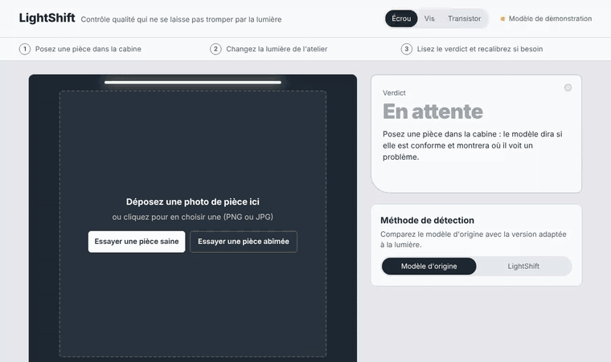
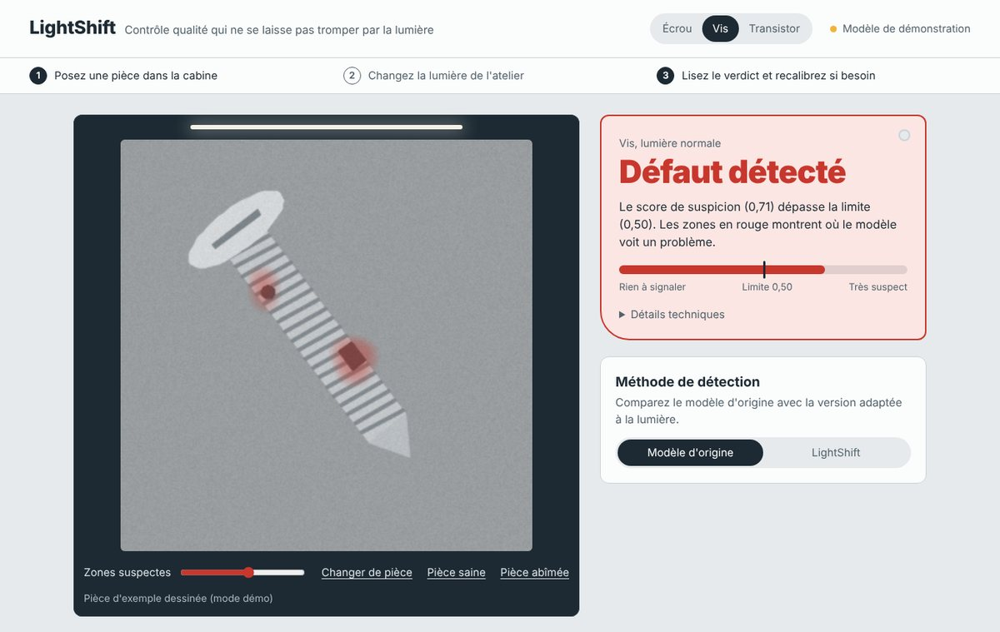
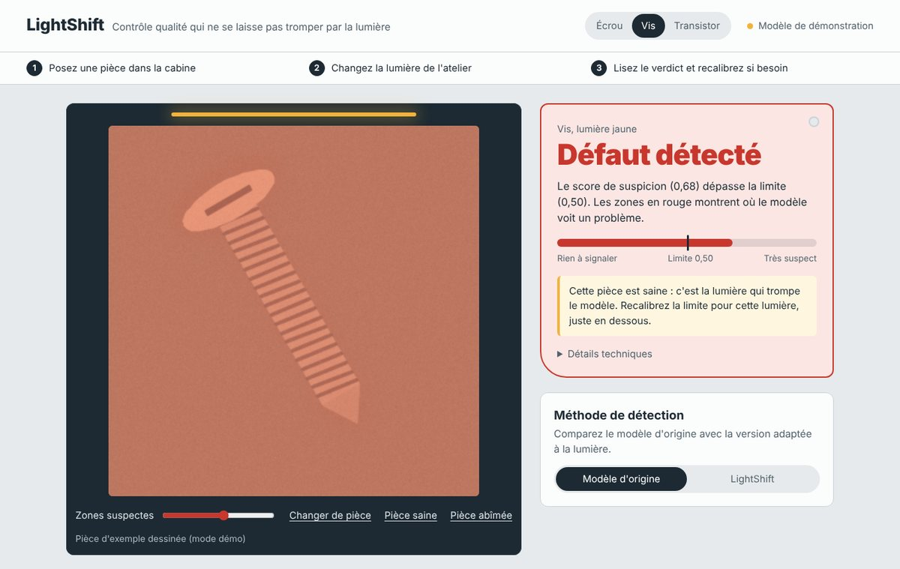
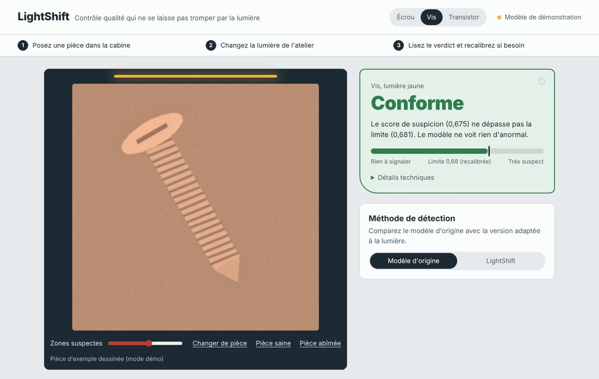
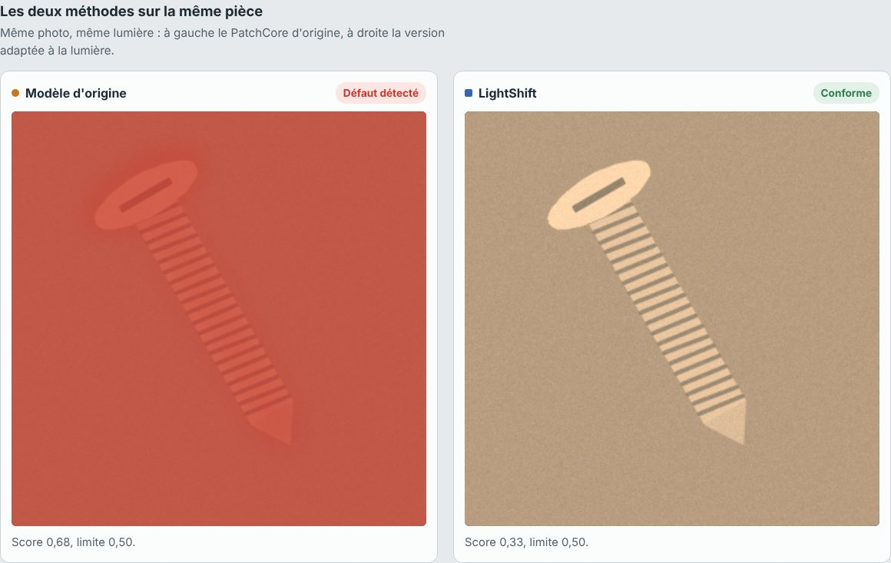
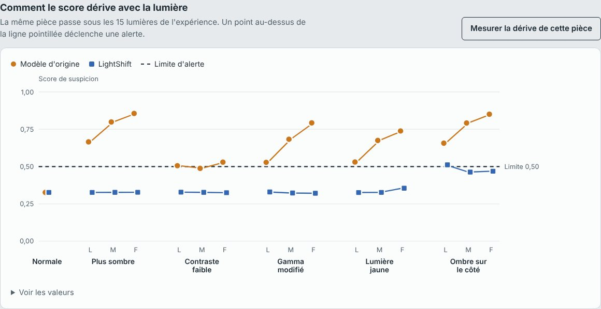

# Application LightShift-PatchCore (membre 3)

Une API FastAPI et une interface web « banc d'inspection » pour utiliser et démontrer PatchCore
sous changement d'éclairage. L'interface est servie par l'API elle-même : un seul programme à lancer.

```
Photo ──► /predict ──► modèle (démo ou PatchCore) ──► score + limite ──► Conforme / Défaut + zones en rouge
Pièces saines sous la nouvelle lumière ──► /calibrate ──► nouvelle limite (brique B3)
```



| Défaut détecté | Fausse alerte due à la lumière jaune | Après recalibration (B3) |
|---|---|---|
|  |  |  |

| Les deux méthodes sur la même pièce | Dérive du score selon la lumière |
|---|---|
|  |  |

*Captures en mode démo (pièces dessinées, modèle de démonstration) : elles illustrent l'interface, pas des résultats expérimentaux.*

## Lancer en local

```powershell
py -m venv .venv
.venv\Scripts\Activate.ps1          # Linux/Mac : source .venv/bin/activate
python -m pip install -r requirements-app.txt
python -m uvicorn app.api.main:app --reload
```

Ouvrir ensuite :
- **http://localhost:8000** : l'interface
- **http://localhost:8000/docs** : la documentation de l'API

## L'interface

| Zone | À quoi elle sert |
|---|---|
| Cabine | Déposer une photo, ou essayer une pièce saine ou abîmée générée. Le curseur « Zones suspectes » règle l'affichage du rouge |
| Lumière de l'atelier | 6 lumières (normale, plus sombre, contraste faible, gamma, jaune, ombre) × 3 intensités. Ce sont les mêmes transformations que celles du membre 1 |
| Étiquette de verdict | « Conforme » ou « Défaut détecté », avec une phrase simple, une jauge score/limite et un conseil quand la lumière trompe le modèle |
| Méthode | Modèle d'origine ou LightShift pour le verdict principal |
| Les deux méthodes sur la même pièce | **Comparaison côte à côte** : même photo, même lumière, PatchCore d'origine à gauche, LightShift à droite |
| Comment le score dérive avec la lumière | **Vue de dérive** : score de la pièce sous les 15 lumières, pour les deux méthodes, avec la limite. Survol pour les valeurs, tableau dans « Voir les valeurs » |
| Recalibrer | Brique B3 : nouvelle limite calculée à partir de pièces saines sous la lumière choisie |
| Pièces inspectées | Historique des dernières inspections avec leur verdict |

## Le modèle de démonstration (`MODEL_BACKEND=mock`, par défaut)

C'est un **mini-PatchCore sans réseau de neurones** (`app/models/mock.py`). Il garde en mémoire des
patchs de pièces d'exemple saines et compare chaque patch au plus proche voisin. Il reproduit donc
le comportement du vrai modèle :

- une pièce abîmée est détectée ;
- un changement de lumière provoque de **fausses alertes** sur les pièces saines ;
- la **recalibration** (B3) supprime ces fausses alertes ;
- la méthode « LightShift » (normalisation par canal, idée de B2) résiste à la plupart des lumières,
  **sauf à l'ombre**, qui est un gradient spatial. C'est la même limite que dans les résultats du membre 1.

⚠️ Ses scores n'ont aucune valeur scientifique. Il est pensé pour les pièces d'exemple : une vraie
photo MVTec sera jugée « inconnue ». Pour MVTec, il faut le vrai modèle.

## Passer au vrai PatchCore avec les photos MVTec AD

1. **Dataset** : télécharger MVTec AD sur le site officiel (licence CC BY-NC-SA 4.0) et placer
   `metal_nut`, `screw` et `transistor` dans `data/raw/mvtec_anomaly_detection/`.
2. **Checkpoints** : demander les 3 `model.ckpt` au membre 1 et les placer dans
   `results/Patchcore/MVTecAD/<category>/latest/weights/lightning/model.ckpt`.
   Sinon, les recréer avec `python src/models/train_patchcore.py --category <category>`.
3. **Dépendances lourdes** : `python -m pip install -r requirements.txt` (torch CPU + anomalib 2.7.1).
4. **Vérifier le branchement** :
   ```powershell
   python scripts/check_patchcore.py
   ```
   Le script analyse des photos saines et défectueuses de chaque catégorie, compare les scores et
   mesure la latence. Il termine par « ✓ branchement OK » ou indique ce qui manque.
5. **Lancer l'application** :
   ```powershell
   $env:MODEL_BACKEND="patchcore"; python -m uvicorn app.api.main:app --reload
   ```
   L'en-tête indique « PatchCore connecté ». Les boutons « Essayer » proposent alors de **vraies
   photos MVTec**, avec leur nom de fichier et le type de défaut affichés sous la cabine.

### Quelles photos MVTec sont utilisées ?

| Usage | Photos | Pourquoi |
|---|---|---|
| « Essayer une pièce saine » | `test/good`, une photo sur deux (indices impairs) | Photos jamais vues par le modèle |
| « Essayer une pièce abîmée » | `test/<type_de_défaut>/` | Vrais défauts annotés par MVTec |
| Recalibration (« Pièces saines d'exemple ») | `test/good`, l'autre moitié (indices pairs) | Jamais proposée à l'essai : pas de fuite entre calibration et verdict |
| — | `train/good` | **Jamais utilisé** : ces photos ont construit la mémoire de PatchCore |

Vous pouvez aussi déposer n'importe quelle photo dans la cabine. Prenez les photos **d'origine** :
c'est la console de l'atelier qui applique les changements de lumière.

### Scores bruts

L'application utilise les scores **bruts** de PatchCore et la limite apprise par anomalib (voir
`docs/API_CONTRACT.md`). Les scores normalisés d'anomalib sont coupés à 1, ce qui empêcherait la
recalibration sous un fort changement de lumière.

### Ce qui a été vérifié

Le branchement a été testé avec anomalib 2.7.1 et torch 2.15 (les versions du membre 1). Pour ce
test, un checkpoint a été entraîné avec `src/models/train_patchcore.py`, sur une fausse arborescence
MVTec et avec `pre_trained=False`, faute d'accès aux poids ImageNet : chargement, scores, carte des
défauts, recalibration, dérive, catégorie sans checkpoint (503), LightShift pas encore livré (501).
**À refaire avec les vrais checkpoints** grâce à `scripts/check_patchcore.py`.

## Tester sans rien installer : GitHub Codespaces

1. Sur la page GitHub du dépôt, choisir la branche `feature/app-api`.
2. **Code → Codespaces → Create codespace on feature/app-api** (l'installation prend 2 à 3 minutes).
3. Dans le terminal du Codespace : `python -m uvicorn app.api.main:app --host 0.0.0.0`
4. L'interface s'ouvre dans un nouvel onglet (port 8000, « Interface LightShift »).

Penser à arrêter le Codespace après le test (**Codespaces → Stop**), pour ne pas consommer le quota gratuit.

## Intégration continue

`.github/workflows/tests.yml` lance à chaque push :
1. les tests sur Python 3.11 et 3.12 ;
2. la construction de l'image Docker, puis un appel à `/health` pour vérifier qu'elle démarre.

Le résultat apparaît dans l'onglet **Actions** du dépôt GitHub.

## Docker

```bash
docker compose up --build                                        # mode démo
INSTALL_PATCHCORE=true MODEL_BACKEND=patchcore docker compose up --build   # vrai modèle
```

## Tests

```bash
python -m pytest -q
```

Les 40 tests couvrent : le contrat de sortie, les images invalides, vides ou manquantes, les
paramètres invalides, le déterminisme, la calibration (mise à jour, minimum d'images, par
catégorie, remise à zéro, persistance), la baisse des fausses alertes après recalibration, la
robustesse de LightShift, la garantie FPR ≤ α sur données simulées, le modèle absent (503), les
pièces d'exemple, l'interface servie, la vue de dérive et les percentiles de latence.

## Scénario de démo pour le jury (≈ 2 minutes)

1. **Pièce saine, lumière normale** → Conforme.
2. **Pièce abîmée** → Défaut détecté, avec la rayure en rouge.
3. **Pièce saine + lumière jaune** → fausse alerte. Le conseil explique que c'est la lumière qui trompe le modèle.
4. **Recalibrer pour cette lumière** → la limite monte et la pièce saine redevient conforme.
5. **Pièce abîmée sous la même lumière** → toujours détectée.
6. **Les deux méthodes sur la même pièce** → sous lumière jaune, le modèle d'origine se trompe et LightShift non.
7. **Vue de dérive** → d'un coup d'œil, le score du modèle d'origine monte avec chaque lumière, alors que LightShift reste stable, **sauf à l'ombre**.

## Structure

```
app/
├── api/main.py            # endpoints + sert l'interface
├── api/schemas.py         # format des réponses (contrat D11)
├── core/conformal.py      # seuil conforme (B3)
├── core/imaging.py        # lecture d'image, zones rouges, base64
├── core/lighting.py       # réutilise apply_shift() du membre 1
├── core/thresholds.py     # sauvegarde des limites recalibrées
├── models/examples.py     # pièces d'exemple (écrou, vis, transistor)
├── models/mock.py         # mini-PatchCore de démonstration
├── models/patchcore_backend.py  # vrais checkpoints + emplacement du membre 2
├── models/registry.py     # choix du modèle (MODEL_BACKEND)
└── web/index.html         # interface (HTML/CSS/JS, aucune dépendance)
```
